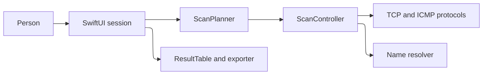
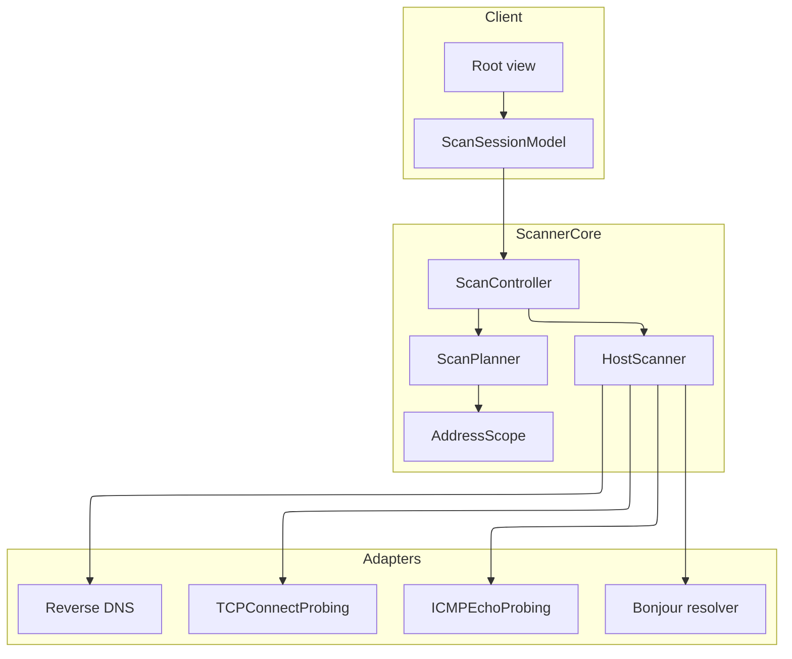
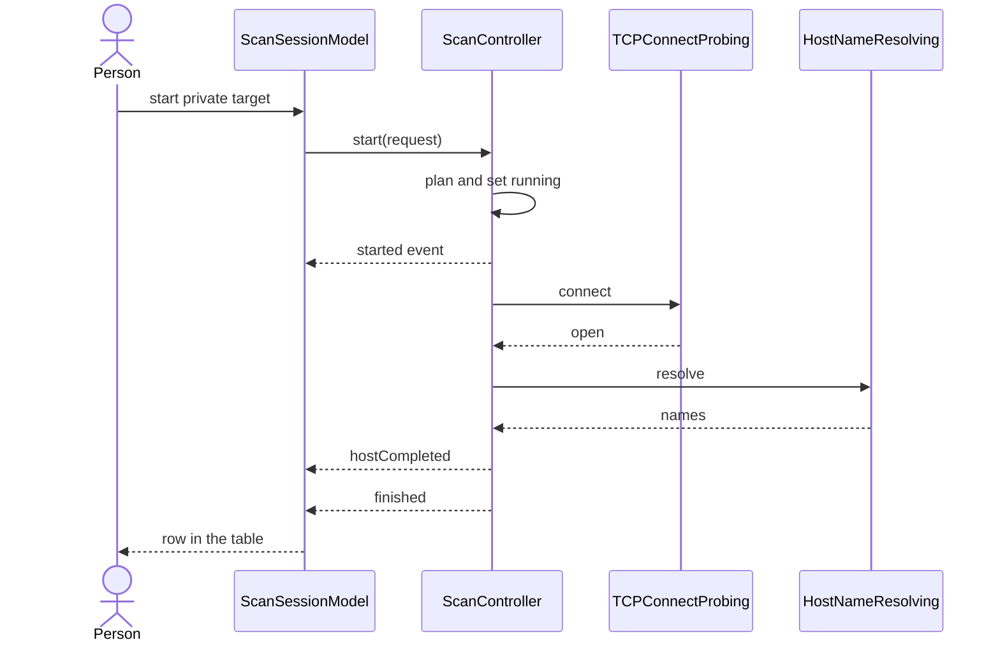
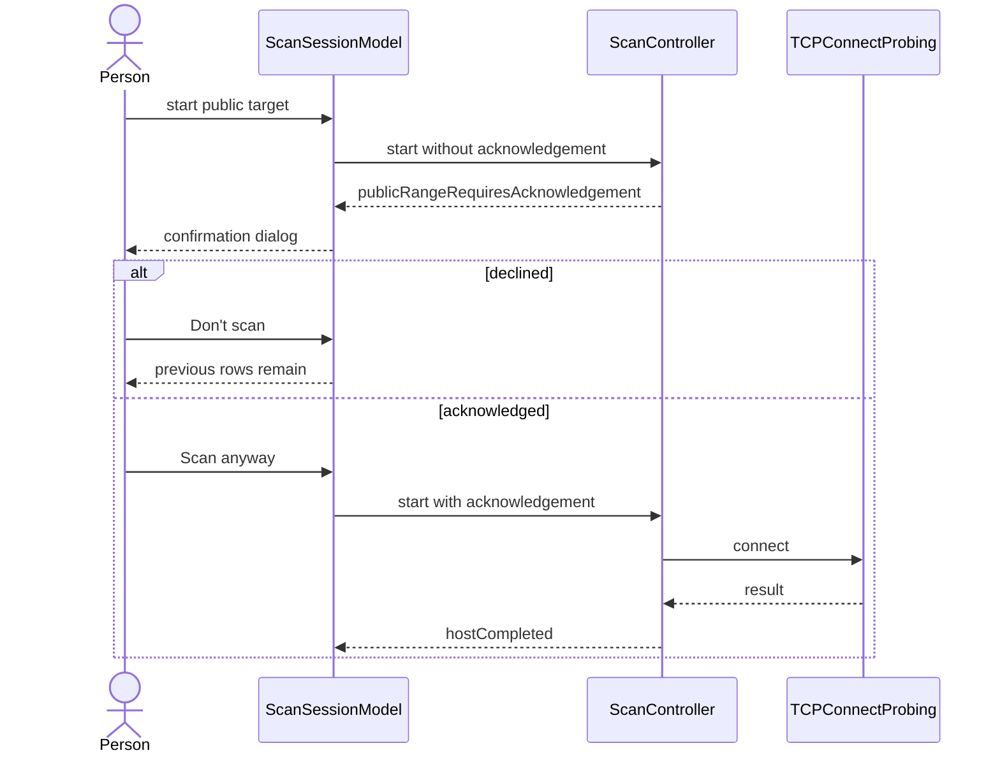
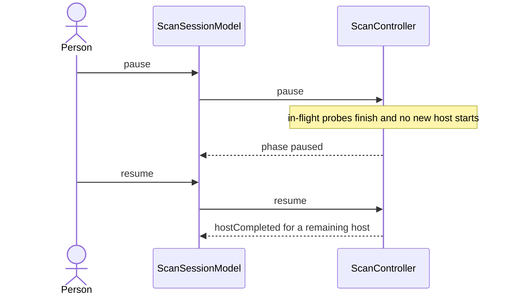
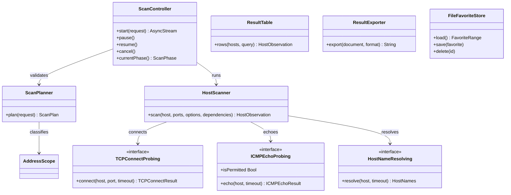
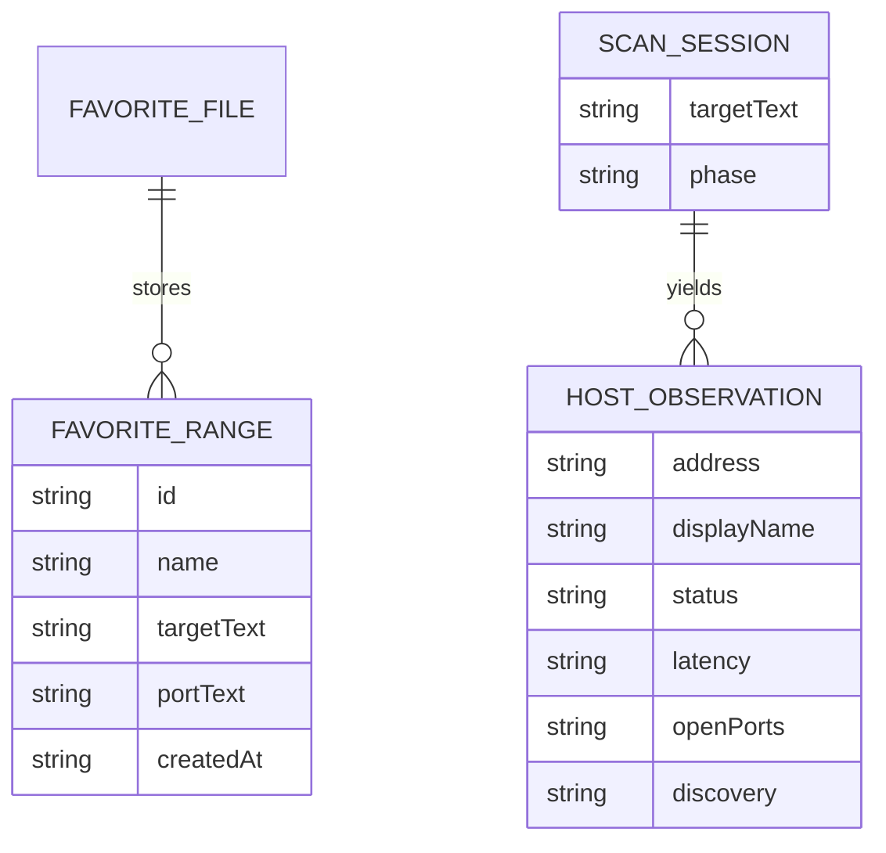
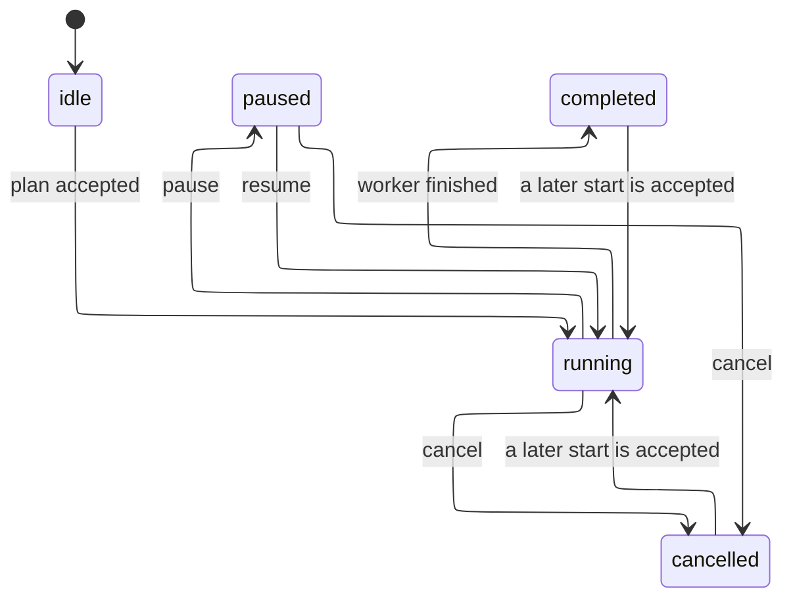
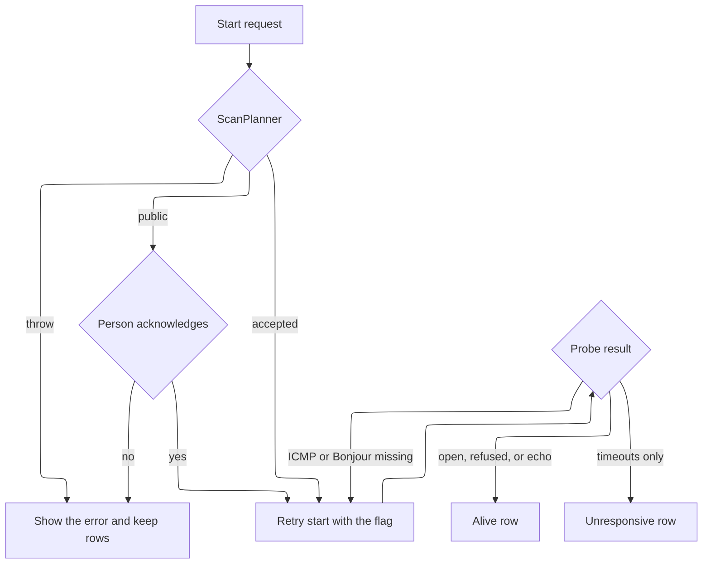

# Design Document

## Overview

v0.1 is a multiplatform SwiftUI app over a Swift package named `ScannerCore`. The package parses targets, enforces the public-range gate, schedules probes, resolves names, filters rows, exports text, and stores favorites. The app is a client of that API. This is a Quick Spec: requirements, design, and tasks were written in one pass because the request asked for the spec and the v0.1 implementation together. Gates were not presented separately.

Guiding constraint: the same scheduler must run on iOS, where raw ICMP is unavailable, and in Linux `swift test`, where `Network.framework` is unavailable. Probe protocols win over calling `NWConnection` from the scheduler. See [ADR 0001](../../../docs/adr/0001-probe-protocols.md) and [ADR 0002](../../../docs/adr/0002-ethical-range-gate.md).

| Decision | Rejected alternative |
| --- | --- |
| IPv4 only in v0.1 | IPv6 in the same scheduler before the IPv4 path is tested |
| TCP refusal counts as alive | Counting only open ports, which hides hosts that are up with closed ports |
| Public includes CGNAT and documentation prefixes | Treating `100.64.0.0/10` as private |
| Host cap default 4096 | Expanding a `/16` or larger on a phone |
| Bonjour label is the advertised service instance whose resolved address matches | Blocking the scan on a full service inventory |
| Working title stays Subnet Scout | Renaming the repository during implementation |

Requirement coverage: 1.1–1.3 and 2.1–2.4 and 6.1–6.3 are `ScanPlanner`. 1.4–1.5 are `InterfacePreference` and the current-subnet control. 3.1–3.3 are `AddressScope` plus the controller gate and the confirmation dialog. 4.1–4.5 and 7.1–7.4 and 8.1–8.4 and 13.1 are `ScanController`. 5.1–5.4 are `CompositeHostNameResolver`. 6.4–6.5 are the TCP probe result mapped by the controller. 9.1–9.5 are `ResultTable` and the results view. 10.1–10.5 are `FileFavoriteStore` and the sidebar. 11.1–11.4 are `ResultExporter` and the export control. 12.1–12.4 are `Info.plist`, the macOS entitlement, and the absence of a MAC field. 14.1–14.3 are optional tasks and are not built in v0.1.

## Architecture

The app process owns `ScanSessionModel` on the main actor. A start request is validated inside `ScanController.start`, which calls `ScanPlanner.plan` before it changes phase to `running` and before it calls a probe. A thrown `ScanValidationError` leaves the previous observations in the model.

The controller's worker is a child `Task` that is not isolated to the actor for the whole loop. It hops to the actor only to wait for pause, to publish phase, and to read cancellation. That keeps `pause` from queueing behind `group.next()`. Per-host work is `HostScanner`, a stateless enum. Inside one host, ICMP (when permitted and enabled) runs beside TCP probes. At most eight TCP probes for that host run at once. That internal port width is not the user-facing concurrency, which counts hosts (requirement 7.3).

Platform adapters are selected by `ScanDependencies.live`. Apple uses `NetworkTCPProbe` and `NetworkBonjourResolver`. macOS uses `ProcessPingProbe`. iOS uses `UnavailableICMPProbe` (`isPermitted == false`). Linux uses `POSIXTCPProbe` and the unavailable ICMP and Bonjour adapters. `SystemReverseDNSResolver` and `SystemInterfaceListing` exist on both Darwin and Glibc.

Deployment notes that change the design:

- iOS and iPadOS show the Local Network prompt from `NSLocalNetworkUsageDescription` and `NSBonjourServices`. There is no raw ICMP path.
- macOS embeds App Sandbox with `com.apple.security.network.client` and `com.apple.security.network.server` (Bonjour). `ProcessPingProbe` may return `unavailable` inside the sandbox. TCP still runs.
- Unsigned CI builds set `CODE_SIGNING_ALLOWED=NO`. Entitlements are applied for the macOS SDK only, so the iOS simulator build does not embed the sandbox entitlement file.

## Components and Interfaces

### ScanPlanner

Expands a target and parses ports. It does not open sockets. It rejects empty and unknown targets, inverted ranges, counts above `hostCap`, concurrency outside `1...256`, non-positive timeouts, and illegal port lists. CIDR input masks host bits, so `192.168.1.50/24` is the 256 addresses of `192.168.1.0/24`. Last-octet shorthand is `192.168.1.10-20`. A full range is `192.168.1.10-192.168.1.20`. Leading zeros in an octet are invalid.

### AddressScope

Classifies one `IPv4`. `privateLocal` is only the five prefixes in requirement 3.1. `publicRange` is everything else. `ScanPlanner` throws `publicRangeRequiresAcknowledgement` when any host is `publicRange` and the flag is false. That throw is the warning gate. The dialog is view state and must not probe by itself.

### InterfacePreference

`SystemInterfaceListing` reads `getifaddrs`. `InterfacePreference.preferred` drops loopback, then prefers a private or local address with a prefix shorter than 32, then any other non-loopback prefix shorter than 32. `CurrentSubnet.select` turns that interface into CIDR text, or into the failure message in requirement 1.5 with a nil target so the caller can leave the field unchanged.

### Probes

`TCPConnectProbing.connect` returns `open`, `refused`, `timedOut`, or `failed`, and must stop waiting at `timeout`. `open` is an open port. `refused` and `timedOut` are not open ports. `ICMPEchoProbing` exposes `isPermitted`. When that is false the controller does not call `echo`. When `echo` returns `unavailable` or `unresponsive`, TCP results still decide the host. `NetworkTCPProbe` is the Apple implementation. `POSIXTCPProbe` is the Linux implementation and the loopback test double's real subject.

### HostScanner and ScanController

`HostScanner.scan` starts the clock, races the permitted ICMP probe with the port probes, and sets latency at the first alive evidence. Discovery priority is ICMP reply, then any open port, then any refusal, else none. Status is alive unless discovery is none. Display name comes from `HostNames.displayName`, which returns the Bonjour name when it is non-empty and otherwise reverse DNS.

`ScanController` methods:

| Operation | Behavior |
| --- | --- |
| `start` | Plans, or throws and stays in the previous phase. Returns a stream of `started`, `hostCompleted`, `finished`, or `cancelled` |
| `pause` | From `running` only, stops issuing hosts |
| `resume` | From `paused` only |
| `cancel` | From `running` or `paused`, cancels the worker and keeps rows already yielded |
| `currentPhase` | `idle`, `running`, `paused`, `cancelled`, or `completed` |

A second `start` during `running` or `paused` throws `alreadyRunning` and does not cancel the first worker.

### Names, results, export, favorites

`CompositeHostNameResolver` queries reverse DNS and Bonjour together. `UnavailableBonjourResolver` returns nil so requirement 5.4 holds on Linux and when the Apple browser cannot run. `NetworkBonjourResolver` browses the service types in `BonjourServiceTypes.defaults` for the name budget (default 2 seconds), resolves endpoints to IPv4, and caches the first instance name per address.

`ResultTable.rows` filters and sorts a copy. Address order is numeric. Empty display names sort after non-empty names when sorting by name ascending. Missing latency sorts after known latencies when sorting by latency ascending. The underlying array is not mutated (requirement 9.5).

`ResultExporter.export` writes CSV, JSON, or TXT from a `ScanExport` value. CSV fields that need it are quoted. Latency is integer milliseconds or an empty CSV field and JSON null.

`FileFavoriteStore` reads and writes a JSON array. `save` rejects an empty name and a name equal to another favorite under case-insensitive comparison. `delete` removes one id. A missing file loads as an empty list.

## Data Models

`IPv4` stores host-order `UInt32`. `HostObservation` is one finished host: address, optional reverse DNS, optional Bonjour name, derived display name, status, optional latency, open ports in ascending order, and discovery method. Observations are not written to disk in v0.1.

`FavoriteRange` is the persisted record: `id`, `name`, `targetText`, `portText`, `createdAt`. `ScanRequest` is the transient input: target text, port text, options, and `acknowledgePublicRange`. `ScanOptions` holds `maxConcurrentHosts` (default 32), `probeTimeout` (default 1 second), `hostCap` (default 4096), `useICMPWhenPermitted` (default true), and `nameBudget` (default 2 seconds).

There is no MAC property on `HostObservation`. Requirements 12.3 and 12.4 are satisfied by omission.

Illegal transitions: `idle` to `paused`, `paused` to `completed`, `completed` to `paused`, and `running` to `running` via a second start. A second start throws `alreadyRunning` and stays on the current phase. `pause` outside `running`, `resume` outside `paused`, and `cancel` outside `running` or `paused` are ignored.

## Error Handling

Validation errors are `ScanValidationError`. Probe misses are values, not throws. A favorite name collision is `FavoriteStoreError` and does not touch the file. A corrupt favorites file throws from `load` and the app shows the message without replacing an in-memory list it has not read.

| Condition | Response | State afterward |
| --- | --- | --- |
| Empty or unknown target | `emptyTarget` or `invalidTarget` | Previous rows, idle |
| Inverted range | `invertedRange` | Previous rows, idle |
| Host count above the cap | `rangeTooLarge` | Previous rows, idle |
| Bad ports | `invalidPortList` | Previous rows, idle |
| Concurrency or timeout out of range | `invalidConcurrency` or `invalidTimeout` | Previous rows, idle |
| Public address without the flag | `publicRangeRequiresAcknowledgement` | Previous rows, idle, dialog shown |
| User declines the dialog | No second `start` | Previous rows, idle |
| Start while running or paused | `alreadyRunning` | In-progress scan unchanged |
| ICMP unavailable | TCP results only | Scan completes |
| Bonjour unavailable | Reverse DNS only | Scan completes |
| Empty favorite name or duplicate | `FavoriteStoreError` | File unchanged |
| Delete of an unknown id | No error | Other favorites remain |
| Export with zero hosts | Empty document per format | Rows unchanged |

## Testing Strategy

- Unit: target expansion and rejection (1.1–1.3, 2.1–2.4), port lists (6.1–6.3), address scope (3.1), interface preference (1.4, 1.5), result query (9.2–9.5), exporters (11.1–11.4), favorites (10.1, 10.3–10.5), composite names (5.1–5.4).
- Controller: public gate sends no probes (3.2, 3.3), private start does (3.1), TCP open and refused and timeout mapping (4.3–4.5, 6.4, 6.5), ICMP permitted path and unavailable path (4.1, 4.2), latency presence (7.1, 7.2), host concurrency (7.3), pause, resume, cancel, and same-state calls (8.1–8.4), second start (13.1).
- Integration: `POSIXTCPProbe` against a loopback listener for an open port and a closed port (6.4, 6.5, 7.4). Timeout is asserted by a scripted probe so the suite does not depend on packet filters.
- Property: expanding a prefix of length `n` from 24 through 32 yields `2^(32-n)` addresses when the cap allows. Validates: Requirement 1.3.
- Property: numeric address sort is not lexicographic, so `192.168.1.2` precedes `192.168.1.10`. Validates: Requirement 9.2.
- Property: an unacknowledged public plan throws and the scripted probe count stays 0. Validates: Requirement 3.2.
- Property: CSV line count is the host count plus the header. Validates: Requirement 11.1.
- App checks that are file review rather than a Linux test: Info.plist keys (12.1), macOS entitlement (12.2), no MAC field (12.3, 12.4), favorite selection fills the fields (10.2), launch loads the store (10.5), the table shows the five columns (9.1).
- Requirements 14.1–14.3 have no v0.1 test because those tasks stay optional and undone.

Residual risks after the Quick Spec analysis:

- Sandboxed macOS often cannot ICMP. The TCP fallback is the supported path, and a green Linux run does not prove `ping` works on a Mac.
- `getnameinfo` is not cancellable. A slow resolver can outlive the timeout that already returned nil.
- Bonjour instance names depend on the Local Network grant and on a short browse budget, so a device can be alive with an empty Bonjour name.
- The acknowledgement dialog is not a substitute for permission to scan a network.
- The product title collides with an existing App Store app. v0.1 keeps the working name on purpose.
