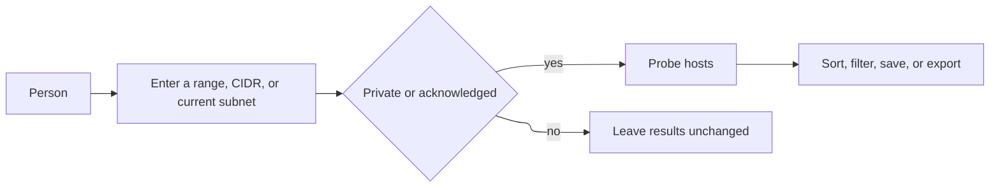
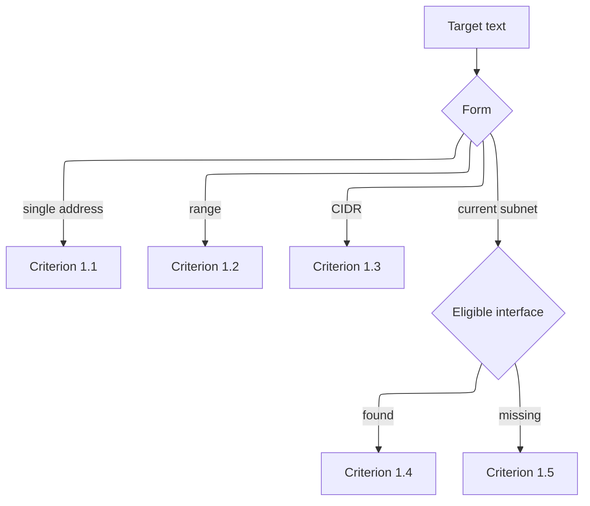
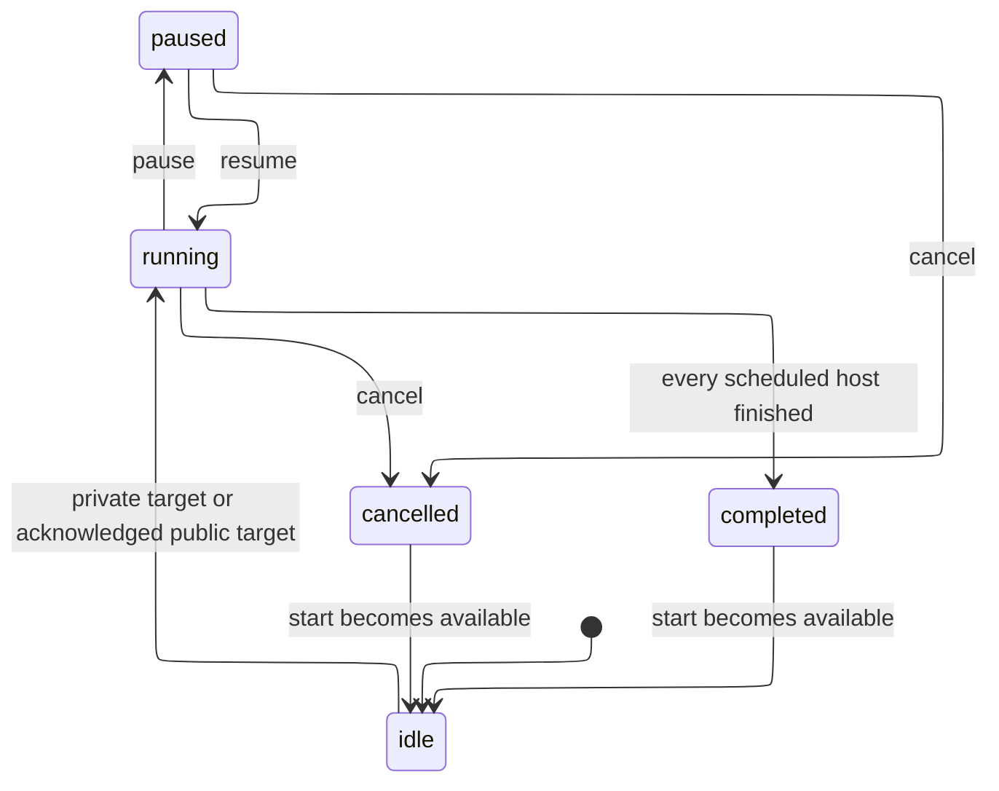

# Requirements Document

## Introduction

Subnet Scout v0.1 lets a person scan an IPv4 range on iPhone, iPad, and Mac, see which hosts respond, and export the rows. The working name of this repository is Subnet Scout. v0.1 does not include IPv6, ARP or MAC addresses, UDP, banners, or persisted scan history.

This pass is a Quick Spec. The request asked for requirements, design, tasks, and the v0.1 implementation together, so the phase gates were not stopped for separate approval. Residual risks are listed in the design.

### Name check

Checked on 2026-11-01 against the Apple iTunes Search API, GitHub repository search, and public trademark references. This is not a legal opinion or a full clearance search.

**The working name does not look safe to ship.** Keep it on `sohampatwardhan/subnet-scout` until a human renames the product. Do not rename the repository as part of implementation.

| Source | What turned up |
| --- | --- |
| App Store | An app already named Subnet Scout, by Jonas Nordlund, bundle id `com.jnordlund.subnet-scout`, Apple ID 6793469696, Utilities, free. Listing: https://apps.apple.com/us/app/subnet-scout/id6793469696 |
| Nearby App Store titles | Network Scout by Csaba Iranyi (id 960812333), a network-discovery utility. Scout IP by Mikhail Kasianov (id 6738300344), an IP information utility |
| GitHub | Other repositories named `subnet-scout` exist for unrelated Bittensor tools (`gueysito/subnet-scout`, `Jeffrey978/subnet-scout`, `shadowosx/subnet-scout`). `Jaap79/PhpSubnetScout` is a Windows subnet scanner for PHP sites |
| Trademarks | No exact "SUBNET SCOUT" registration showed up in this quick search. NETSCOUT is a live mark of NetScout Systems, Inc. for network analysis software (US registration 1,764,154 and later filings). That owner has opposed SCOUT-formative and NET-formative marks in related goods. A likelihood-of-confusion argument against "Subnet Scout" on network software is plausible |

Proposed alternatives, checked the same day. None had an exact App Store title in the search results, and GitHub name search returned no `lantern-sweep`, `harbor-sweep`, or `lumen-range` repository:

1. **Lantern Sweep.** Preferred if the working name is retired. Nearby hits were lantern games and lighting apps, not network utilities.
2. **Harbor Sweep.** Nearby hits were harbor guides and games. "Harbor" is a common word and still needs a trademark search before a filing.
3. **Lumen Range.** Nearby hits were light meters and flashlights. Weaker than Lantern Sweep because "Lumen" is already used on lighting products.

## Requirements

### Requirement 1

**User Story:** As a network admin, I want to choose an IPv4 target, so that I can scan one host, a range, or the subnet I am on.

#### Acceptance Criteria

1. WHEN the user submits a single IPv4 address THEN the system SHALL scan that address only.
2. WHEN the user submits an inclusive range as `start-end` or as a last-octet shorthand `address.startOctet-endOctet` THEN the system SHALL scan every address from the start through the end inclusive.
3. WHEN the user submits a CIDR prefix THEN the system SHALL scan every address in the network that contains that prefix, including the network address and the broadcast address.
4. WHEN the user asks for the current subnet AND an eligible local IPv4 interface exists THEN the system SHALL select that interface's network prefix as the target text.
5. IF no eligible local IPv4 interface exists WHEN the user asks for the current subnet THEN the system SHALL leave the target text unchanged AND SHALL report "No local IPv4 subnet detected."

### Requirement 2

**User Story:** As a network admin, I want invalid scan requests rejected, so that a typo does not wipe results or send probes.

#### Acceptance Criteria

1. IF the target text is empty or not a supported IPv4 form THEN the system SHALL reject the scan AND SHALL NOT send probes AND SHALL leave the stored result set unchanged.
2. IF the expanded host count is greater than the configured cap THEN the system SHALL reject the scan AND SHALL NOT send probes AND SHALL leave the stored result set unchanged.
3. IF a range end is below its start THEN the system SHALL reject the scan AND SHALL NOT send probes AND SHALL leave the stored result set unchanged.
4. IF concurrency is outside 1 through 256 OR the probe timeout is not positive THEN the system SHALL reject the scan AND SHALL NOT send probes AND SHALL leave the stored result set unchanged.

### Requirement 3

**User Story:** As a person on a shared network, I want public ranges blocked until I acknowledge them, so that a scan of the public Internet does not start by accident.

#### Acceptance Criteria

1. WHEN every expanded address is private or local THEN the system SHALL start the scan without a public-range warning. Private or local means `10.0.0.0/8`, `172.16.0.0/12`, `192.168.0.0/16`, `127.0.0.0/8`, or `169.254.0.0/16`.
2. IF any expanded address is outside those private and local ranges THEN the system SHALL NOT send probes until the user acknowledges the public-range warning.
3. WHEN the user declines the public-range warning THEN the system SHALL leave the scan idle AND SHALL leave the stored result set unchanged.

### Requirement 4

**User Story:** As a network admin, I want hosts discovered with ICMP where the platform allows it and with TCP otherwise, so that iOS still finds devices that refuse a port.

#### Acceptance Criteria

1. WHERE ICMP echo is permitted AND the caller enabled ICMP THEN the system SHALL send an ICMP echo probe to the host.
2. WHERE ICMP echo is not permitted OR the ICMP probe returns unavailable THEN the system SHALL continue the scan with TCP connect probes AND SHALL NOT fail the scan because ICMP is missing.
3. WHEN a TCP connect probe opens a connection OR receives a connection refusal THEN the system SHALL record the host as alive.
4. WHEN every probe times out or fails without a refusal AND no ICMP reply arrived THEN the system SHALL record the host as unresponsive.
5. WHEN an ICMP echo reply arrives THEN the system SHALL record the host as alive even if every TCP probe times out.

### Requirement 5

**User Story:** As a network admin, I want a hostname beside each address, so that I can recognize devices without memorizing numbers.

#### Acceptance Criteria

1. WHEN reverse DNS returns a name for an address THEN the system SHALL store that name on the host.
2. WHEN a Bonjour name is learned for an address THEN the system SHALL store that name AND SHALL prefer it over reverse DNS as the display name.
3. IF neither reverse DNS nor Bonjour returns a name THEN the system SHALL leave the display name empty.
4. WHERE Bonjour browsing is unavailable THEN the system SHALL complete the scan using reverse DNS only.

### Requirement 6

**User Story:** As a network admin, I want to choose which TCP ports are checked, so that I can look for the services I care about.

#### Acceptance Criteria

1. WHEN the user supplies a port list of numbers and inclusive ranges THEN the system SHALL probe those TCP ports.
2. WHEN the user does not supply a port list THEN the system SHALL probe the built-in common port list.
3. IF the port list contains a value outside 1 through 65535 OR a descending range OR a token that is not a port THEN the system SHALL reject the scan AND SHALL NOT send probes AND SHALL leave the stored result set unchanged.
4. WHEN a TCP connect succeeds THEN the system SHALL list that port as open.
5. WHEN a TCP connect is refused or times out THEN the system SHALL NOT list that port as open.

### Requirement 7

**User Story:** As a network admin, I want a latency and a bound on parallel work, so that a scan of a /24 stays responsive and comparable.

#### Acceptance Criteria

1. WHEN a host is recorded alive THEN the system SHALL record the elapsed time from the start of that host's probes to the first alive evidence.
2. WHEN a host is unresponsive THEN the system SHALL leave latency empty.
3. WHEN a scan is running THEN the system SHALL probe at most the configured number of hosts at the same time.
4. WHEN the user sets a probe timeout THEN the system SHALL limit each individual probe to that timeout.

### Requirement 8

**User Story:** As a network admin, I want to pause or cancel a scan, so that I can stop traffic without losing rows already collected.

#### Acceptance Criteria

1. WHEN the user pauses a running scan THEN the system SHALL NOT start probes for hosts that have not yet begun AND SHALL keep results already recorded.
2. WHEN the user resumes a paused scan THEN the system SHALL continue with the remaining hosts.
3. WHEN the user cancels a running or paused scan THEN the system SHALL stop scheduling further hosts AND SHALL keep results already recorded.
4. IF pause, resume, or cancel is requested WHILE the scan is already in the requested phase, OR cancel is requested WHILE the scan is idle, THEN the system SHALL leave the phase unchanged.

### Requirement 9

**User Story:** As a network admin, I want to sort and filter the result table, so that I can find one device in a large range.

#### Acceptance Criteria

1. WHEN results are shown THEN the system SHALL present address, display name, status, latency, and open ports for each host.
2. WHEN the user sorts by address, display name, latency, open-port count, or status THEN the system SHALL reorder the rows by that key, with addresses in numeric order.
3. WHEN the user enters filter text THEN the system SHALL show only rows whose address or display name contains that text, ignoring case.
4. WHEN the user asks for alive hosts only THEN the system SHALL hide unresponsive hosts.
5. IF no host matches the filter THEN the system SHALL show an empty table AND SHALL keep the underlying results unchanged.

### Requirement 10

**User Story:** As a network admin, I want to save named ranges, so that I can repeat a lab or home subnet without retyping it.

#### Acceptance Criteria

1. WHEN the user saves a favorite with a name, target text, and port text THEN the system SHALL persist those fields.
2. WHEN the user chooses a favorite THEN the system SHALL fill the target text and port text from that favorite.
3. IF the favorite name is empty OR matches an existing favorite name regardless of case THEN the system SHALL reject the save AND SHALL leave the favorites unchanged.
4. WHEN the user deletes a favorite THEN the system SHALL remove only that favorite.
5. WHEN the app launches THEN the system SHALL load the persisted favorites.

### Requirement 11

**User Story:** As a network admin, I want to export the rows, so that I can keep a copy outside the app.

#### Acceptance Criteria

1. WHEN the user exports CSV THEN the system SHALL produce a header row and one row per host with address, display name, status, latency, open ports, and discovery method.
2. WHEN the user exports JSON THEN the system SHALL produce a document containing the target text and the same host fields.
3. WHEN the user exports TXT THEN the system SHALL produce one readable block per host with those fields.
4. WHEN there are no hosts THEN the system SHALL produce a CSV document with only the header, OR a JSON document with an empty host list, OR a TXT note "No hosts were recorded."

### Requirement 12

**User Story:** As a person installing the app, I want the platform privacy prompts and limits to be honest, so that the app can pass review and does not invent data the OS withholds.

#### Acceptance Criteria

1. WHERE the app runs on iOS or iPadOS THEN the system SHALL include a local-network usage description and the Bonjour service types used by name lookup, so the operating system can present the Local Network prompt.
2. WHERE the app runs on macOS THEN the system SHALL declare the App Sandbox network client entitlement.
3. WHERE the app runs on iOS or iPadOS THEN the system SHALL NOT present a MAC address.
4. WHERE a MAC address is not available THEN the system SHALL omit it rather than invent one.

### Requirement 13

**User Story:** As a network admin, I want only one scan at a time, so that two runs do not mix their rows.

#### Acceptance Criteria

1. IF the user starts a scan WHILE another scan is running or paused THEN the system SHALL reject the new start AND SHALL leave the in-progress scan unchanged.

### Requirement 14

**User Story:** As a network admin, I want later discovery features, so that the v0.1 design does not pretend the product is finished.

#### Acceptance Criteria

1. THE system SHOULD accept IPv6 targets in a later version.
2. WHERE the app runs on macOS THE system SHOULD show a MAC address only when the operating system provides one without elevated privileges.
3. THE system SHOULD persist scan history across launches in a later version.

Criteria 14.1, 14.2, and 14.3 are not v0.1 ship blockers.
