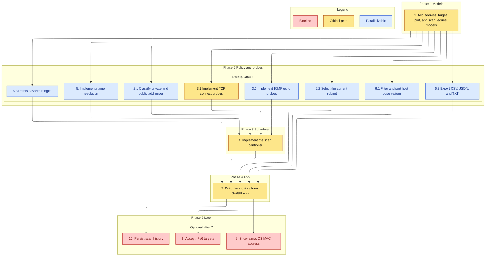

# Implementation Plan

- [x] 1. Add address, target, port, and scan request models
  - Add `IPv4`, `ScanTarget` parsing for a single address, an inclusive range, last-octet shorthand, and CIDR with host bits masked
  - Add `PortSelection` with the common preset and rejection of descending ranges and values outside 1...65535
  - Add `ScanOptions`, `ScanRequest`, `ScanValidationError`, and `HostObservation` fields for address, names, status, latency, open ports, and discovery
  - Reject empty targets, unknown text, inverted ranges, counts above `hostCap`, concurrency outside 1...256, and non-positive timeouts before any probe exists
  - _Requirements: 1.1, 1.2, 1.3, 2.1, 2.2, 2.3, 2.4, 6.1, 6.2, 6.3_

- [x] 2. Classify ranges and choose a local interface
- [x] 2.1 Classify private and public addresses
  - Mark only RFC 1918, loopback, and link-local as `privateLocal`
  - Treat every other address, including `100.64.0.0/10`, as `publicRange`
  - _Requirements: 3.1_
- [x] 2.2 Select the current subnet from interface listings
  - Add `NetworkInterface`, `InterfacePreference.preferred`, `CurrentSubnet.select`, and `SystemInterfaceListing` via `getifaddrs`
  - Prefer a non-loopback private prefix shorter than 32, and return "No local IPv4 subnet detected." when none qualifies
  - _Requirements: 1.4, 1.5_

- [x] 3. Add host probes
- [x] 3.1 Implement TCP connect probes
  - Add `TCPConnectProbing` and `POSIXTCPProbe` with a per-probe timeout
  - Add `NetworkTCPProbe` behind `canImport(Network)` and map handshake success to open and `ECONNREFUSED` to refused
  - _Requirements: 6.4, 6.5, 7.4_
- [x] 3.2 Implement ICMP echo probes
  - Add `ICMPEchoProbing` with `isPermitted`
  - Add `UnavailableICMPProbe` and a macOS `ProcessPingProbe` that returns `unavailable` when `ping` cannot launch
  - _Requirements: 4.1, 4.2_

- [x] 4. Implement the scan controller
  - Plan inside `start` and throw `publicRangeRequiresAcknowledgement` before phase becomes `running` or a probe is called
  - Record alive for ICMP reply, TCP open, or TCP refused, and unresponsive when every probe times out
  - Set latency only for alive hosts, cap in-flight hosts at `maxConcurrentHosts`, and bound each probe by `probeTimeout`
  - Pause before scheduling a not-yet-started host, resume the remainder, and cancel without dropping observations already yielded
  - Leave phase unchanged for pause, resume, or cancel when already in that phase, and throw `alreadyRunning` on a second start
  - _Requirements: 3.1, 3.2, 3.3, 4.1, 4.2, 4.3, 4.4, 4.5, 7.1, 7.2, 7.3, 8.1, 8.2, 8.3, 8.4, 13.1_

- [x] 5. Implement name resolution
  - Add `HostNames`, `SystemReverseDNSResolver`, `UnavailableBonjourResolver`, `NetworkBonjourResolver`, and `CompositeHostNameResolver`
  - Prefer a non-empty Bonjour name over reverse DNS, leave the display name empty when both are missing, and finish when Bonjour returns nil
  - _Requirements: 5.1, 5.2, 5.3, 5.4_

- [x] 6. Add result helpers and favorite persistence
- [x] 6.1 Filter and sort host observations
  - Implement `ResultTable` for address, display name, latency, open-port count, and status, plus case-insensitive text and alive-only filters
  - Return a new array and leave the input unchanged when the filter matches nothing
  - _Requirements: 9.1, 9.2, 9.3, 9.4, 9.5_
- [x] 6.2 Export CSV, JSON, and TXT
  - Write a header and one CSV row per host, a JSON document with the target and host fields, and one TXT block per host
  - Write a header-only CSV, a JSON document with an empty host list, and the TXT note "No hosts were recorded." when there are no hosts
  - _Requirements: 11.1, 11.2, 11.3, 11.4_
- [x] 6.3 Persist favorite ranges
  - Save name, target text, and port text, reject an empty or case-insensitive duplicate name, delete one id, and load an empty list when the file is absent
  - _Requirements: 10.1, 10.3, 10.4, 10.5_

- [x] 7. Build the multiplatform SwiftUI app
  - Add `ScanSessionModel` and views for target, current subnet, ports, concurrency, timeout, pause, resume, cancel, the result table, favorites, and export
  - Show the public-range confirmation, keep rows when planning throws or the person declines, and refuse a second start while a scan is active
  - Fill the form from a chosen favorite and load favorites at launch
  - Add `App/project.yml`, `Info.plist` local-network and Bonjour keys, the macOS network-client entitlement, and no MAC column
  - _Requirements: 1.4, 1.5, 3.2, 3.3, 8.1, 8.2, 8.3, 9.1, 10.2, 10.5, 12.1, 12.2, 12.3, 12.4, 13.1_

- [ ] 8. Accept IPv6 targets (optional)
  - Parse and probe IPv6 ranges with the same public-range gate
  - _Requirements: 14.1_

- [ ] 9. Show a macOS MAC address when the system provides one (optional)
  - Read a MAC only from an unprivileged system API and keep the column omitted on iOS
  - _Requirements: 14.2_

- [ ] 10. Persist scan history (optional)
  - Store finished sessions and reopen them without rescanning
  - _Requirements: 14.3_

## Task graph

Arrows mean depends-on. A task waits until every incoming source is checked. Grouping parents 2, 3, and 6 are not nodes.

Primary critical path: 1, 3.1, 4, 7. That chain delivers host discovery, which is the core state change. Tasks 2.1, 3.2, and 5 also block task 4, and tasks 2.2, 6.1, 6.2, and 6.3 join at task 7. They can run beside 3.1 once task 1 is done. Tasks 8, 9, and 10 are optional, so they are blocked for a required run.

Waves: 1 is wave 1. 2.1, 2.2, 3.1, 3.2, 5, 6.1, 6.2, and 6.3 are wave 2. 4 is wave 3. 7 is wave 4. 8, 9, and 10 are wave 5.
