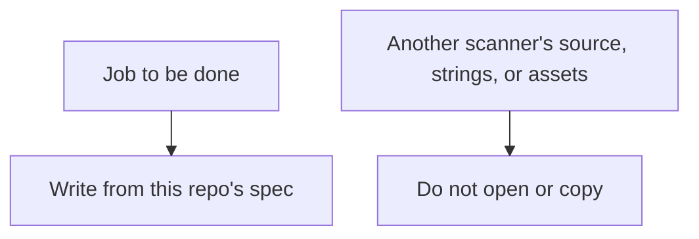

# Clean-room rule

Load this note with `#clean-room` before touching scanner behavior or branding.

Subnet Scout is a clean-room implementation. The category idea is a host scanner. The implementation, copy, icon, and name are original.

## Allowed

- Specify behavior in `.kiro/specs/local-network-scan/`
- Use public platform APIs (`Network`, POSIX, `getifaddrs`, `getnameinfo`, `ping` on macOS)
- Use SF Symbols and the original app icon in `App/SubnetScout/Assets.xcassets`

## Not allowed

- Copy or translate source, tests, resource files, icons, or marketing text from Angry IP Scanner or from any other IP scanner
- Depend on a GPL scanner or vendor its jars, images, or port-preset files
- Use the word "Angry" in the product name, bundle id, or icon
- Commit an MCP config, including an Iconify server entry
- Rename `sohampatwardhan/subnet-scout` while the requirements still call that the working repository name

## Name

The shipping title is unresolved. Keep the working name in the UI until a human picks one of the alternatives in `requirements.md`.
