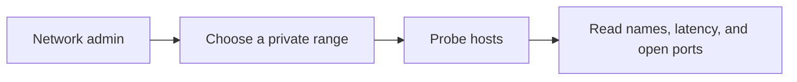

# Product

## Purpose

Subnet Scout is a clean-room, open-source utility that shows which IPv4 hosts on a chosen range respond, what they are named, and which TCP ports are open. The working name stays **Subnet Scout** for this repository. It is not clear for an App Store title; see the name check in the local-network scan requirements.

The product is inspired by the job of a desktop IP scanner. It does not copy that category's code, text, icons, or branding, and it is not named "Angry" anything.

## Users

People who administer a home or lab network and want a native iPhone, iPad, and Mac view of a private subnet.

It is not a surveillance product, a vulnerability exploit kit, or a scanner aimed at public networks. Public ranges require an explicit acknowledgement before any probe is sent.

## Objectives

When a trade-off appears, prefer these in order:

1. Do not probe a range the user has not accepted, and do not probe a public range until they acknowledge the warning.
2. Tell the truth about platform limits. iOS cannot send raw ICMP, and a missing MAC address stays missing.
3. Keep the scanning engine testable without Apple frameworks.
4. Keep the working name until a human renames the product. Do not rename the GitHub repository inside an implementation task.

## In scope

- IPv4 ranges, CIDR prefixes, and the current local subnet
- Concurrent host discovery and TCP port probes
- Reverse DNS and Bonjour display names
- Saved ranges, sorting, filtering, and CSV, JSON, and TXT export
- Pause, resume, and cancel

## Out of scope

- Copying another scanner's implementation or brand
- IPv6, ARP, scan history, banners, and UDP in v0.1
- Hidden or continuous scanning
