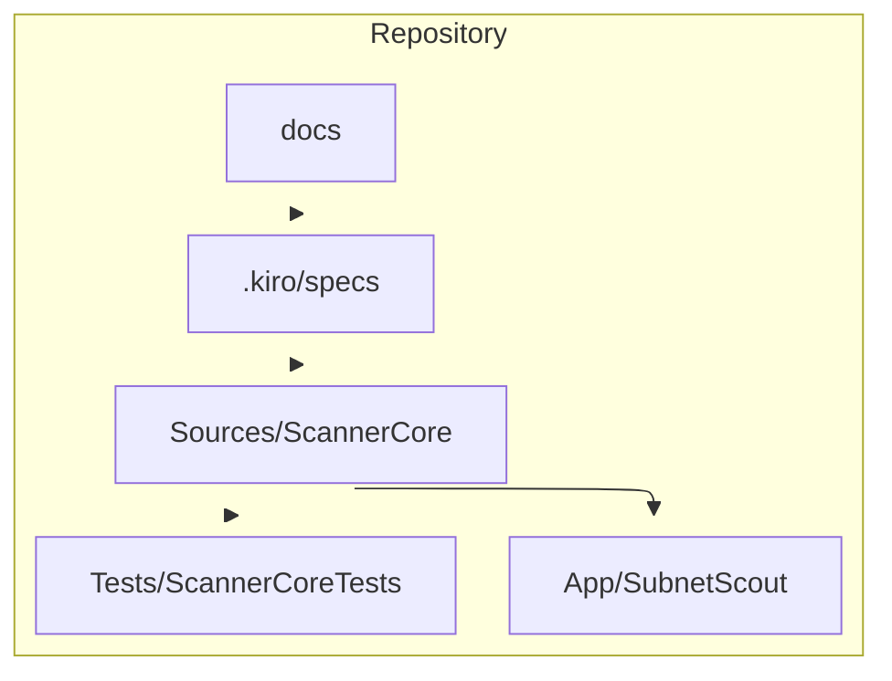

# Project structure

## Layout

```text
Package.swift
Sources/ScannerCore/          # platform-agnostic engine and Apple adapters
Tests/ScannerCoreTests/      # Swift Testing, runnable on Linux
App/project.yml              # XcodeGen spec
App/SubnetScout/             # SwiftUI sources, assets, Info.plist, entitlements
.kiro/specs/local-network-scan/
.kiro/steering/
.kiro/hooks/
docs/architecture.md
docs/adr/
.github/workflows/ci.yml
```

Generated `App/SubnetScout.xcodeproj` is not committed. CI and local builds run XcodeGen first.



## Naming and imports

- Types are `UpperCamelCase`. The IPv4 value type is `IPv4` so it does not collide with `Network.IPv4Address`
- One primary type per file, matching the type name
- The app imports `ScannerCore` and does not reimplement parsing, policy, or export
- New scan behavior lands in `ScannerCore` with tests before the SwiftUI view binds it
- Public API comments use DocC: summary, `- Parameters`, `- Returns` when there is a value, `- Throws` when the function throws
- Bonjour service type strings in `BonjourServiceTypes.defaults` and `App/SubnetScout/Info.plist` stay identical

## Specs and steering

- Specs: `.kiro/specs/<feature-name>/`
- Steering: `.kiro/steering/`
- Hooks: `.kiro/hooks/`
- The v0.1 feature slug is `local-network-scan`
