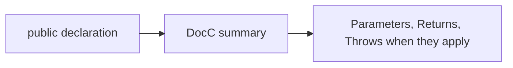

# Swift API comments

Public declarations in `ScannerCore` carry a DocC summary. If the declaration takes inputs, returns a value, or throws, include the matching `- Parameters`, `- Returns`, and `- Throws` lines. Skip those tags when they do not apply.

The app target prefers short comments on non-obvious view logic. It does not duplicate the engine's documentation.

`ScannerCore` stays free of SwiftUI. Platform calls sit behind the probe and resolver protocols, with Apple-only code in files that compile to a no-op or an alternate type on Linux.
