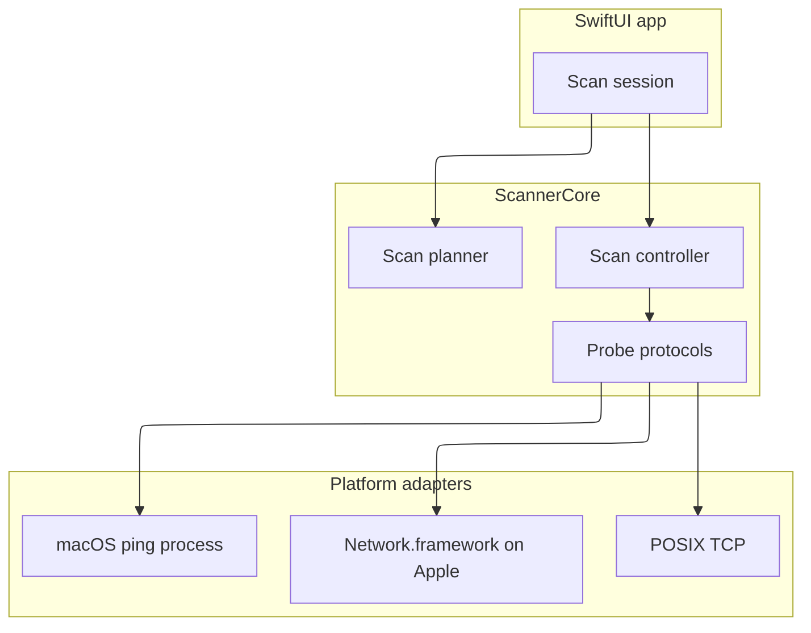

# Technology stack

## Runtime

- Swift 6 language mode, tools version 6.0
- `ScannerCore` is a Swift package with a public, documented API
- SwiftUI app for iOS 17, iPadOS 17, and macOS 14, generated with XcodeGen from `App/project.yml`
- Swift concurrency (`async`/`await`, actors, `TaskGroup`) for the scan scheduler
- `Network.framework` on Apple for TCP connect probes and Bonjour browse
- POSIX TCP connect probes where `Network` is unavailable, including Linux tests
- Swift Testing for package tests

## Data and integrations

- Favorites and last-used scan fields are JSON files in Application Support
- No account, analytics, or cloud API
- ICMP echo is a macOS `ping` process when the sandbox allows it, and is unavailable on iOS
- System reverse DNS uses `getnameinfo`

Live reference:

```text
#[[file:docs/architecture.md]]
#[[file:docs/adr/0001-probe-protocols.md]]
#[[file:docs/adr/0002-ethical-range-gate.md]]
```

## Constraints

- Do not import SwiftUI, UIKit, or AppKit from `ScannerCore`
- Do not require raw sockets, root, or an entitlement Apple will not grant an App Store client
- Abstract `Network.framework` behind protocols so Linux `swift test` exercises the planner, policy, scheduler, exporters, and favorites
- App Sandbox on macOS uses the network client entitlement. iOS relies on the Local Network usage description and `NSBonjourServices`
- Default host cap is 4096. Concurrency must be in `1...256`. Probe timeout must be positive
- Do not commit MCP client configuration. Icons in the interface are SF Symbols. The app icon is an original generated mark


