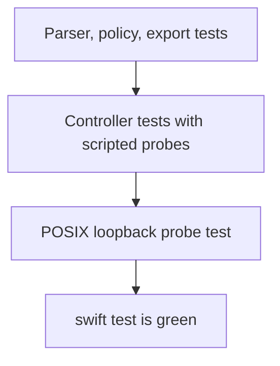

# Testing

## Layout

- Tests live in `Tests/ScannerCoreTests/` and import `Testing` plus `@testable import ScannerCore`
- Name files after the unit under test (`ScanControllerTests.swift`)
- Scripted probes and gates stay in the test target
- A POSIX loopback listener may be used for the real TCP probe. Do not scan off-host addresses in tests
- The SwiftUI target has no separate UI-test bundle in v0.1. Behavior the view calls is covered in `ScannerCore`

## Expectations

- A test that locks an acceptance criterion names that id in a comment on the test, for example `// Requirement 3.2`
- Scheduler tests use scripted probes so they do not depend on the LAN
- Do not assert exact wall-clock latency. Assert that an alive host has a latency and an unresponsive host does not
- Linux `swift test` must pass without `Network.framework`

