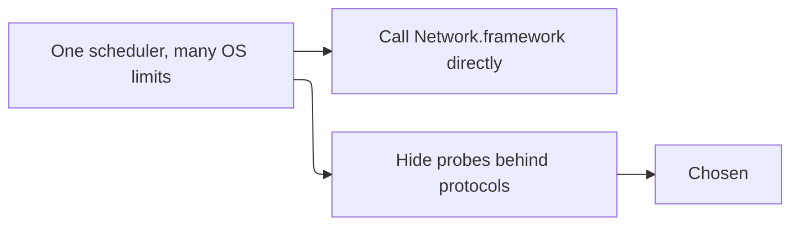

# ADR 0001: Probe protocols instead of calling Network directly

- Status: Accepted
- Date: 2026-11-01

## Context

iOS and iPadOS do not offer raw ICMP sockets to App Store apps. macOS App Sandbox often cannot run `ping` either. Linux CI has no `Network.framework`. The scanner still needs one scheduler for every platform.

The local-network scan requirements that force this split are 4.1, 4.2, 5.4, 12.3, and 12.4.

## Decision

`ScanController` depends on `TCPConnectProbing`, `ICMPEchoProbing`, and `HostNameResolving`. Apple files implement those protocols with `NWConnection`, `NWBrowser`, and `/sbin/ping` where the OS allows it. Linux and tests implement them with POSIX sockets or scripted fakes. A probe that cannot run returns `unavailable` or `isPermitted == false`. The controller falls back to TCP and still finishes the scan.

MAC addresses are not read in v0.1. The model has no field that the UI could fill with a guessed value.

## Consequences

- Package tests run on Linux without Apple frameworks
- Adding a probe does not rewrite the scheduler
- Live ICMP and Bonjour behavior is only as strong as the platform adapter
- Engineers must keep the protocols `Sendable` and must not import SwiftUI into the package

## Alternatives considered

| Alternative | Why it lost |
| --- | --- |
| Raw sockets on every platform | iOS rejects them, and they invite privileged execution |
| Shell out to nmap | Copies nothing, but adds a GPL-adjacent tool dependency and breaks the App Sandbox |
| iOS-only TCP with a separate macOS app | Duplicates the scheduler the package exists to avoid |
