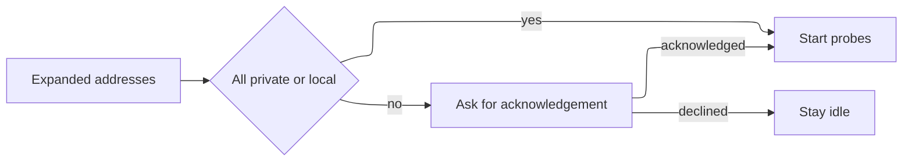

# ADR 0002: Block public ranges until acknowledged

- Status: Accepted
- Date: 2026-11-01

## Context

A host scanner can be aimed at networks the operator does not administer. v0.1 is for local discovery. Requirements 3.1, 3.2, and 3.3 say private and local ranges start normally, and any other address waits for an explicit acknowledgement. Declining leaves stored results untouched and sends no probes.

## Decision

`AddressScope` classifies an address as `privateLocal` only for `10.0.0.0/8`, `172.16.0.0/12`, `192.168.0.0/16`, `127.0.0.0/8`, and `169.254.0.0/16`. Every other IPv4 address is `publicRange`, including CGNAT and documentation prefixes. `ScanPlanner` throws `publicRangeRequiresAcknowledgement` when any expanded address is public and `acknowledgePublicRange` is false. The throw happens before the controller stores a running phase or calls a probe. The SwiftUI client shows a confirmation dialog and retries with the flag set only when the person confirms.

## Consequences

- The gate is unit-tested without a view
- A buggy button cannot skip the check by calling probes itself, because probes are inside the controller
- Shared address space such as `100.64.0.0/10` warns even though it is not globally routed
- The warning is not a legal authorization. The copy says so

## Alternatives considered

| Alternative | Why it lost |
| --- | --- |
| Silently allow every target | Fails the ethical default in the product steering |
| Refuse public ranges forever | Blocks legitimate lab and VPN tests the acknowledgement exists to allow |
| Warn only in the view | A second caller of `ScanController` could skip it |
