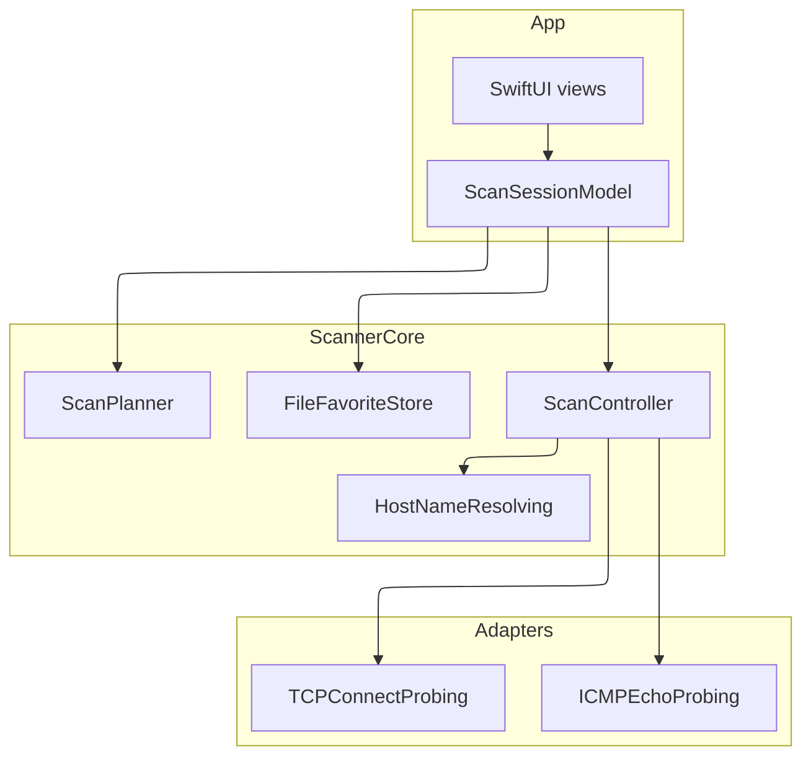

# Architecture

Subnet Scout splits a SwiftUI client from a Swift package, `ScannerCore`, that plans a scan, probes hosts, and formats results. The package is the system of record for policy. The app displays state and collects acknowledgement. It does not decide that a public range is safe on its own.

`ScanPlanner` expands an IPv4 target, parses ports, and refuses empty input, inverted ranges, oversized ranges, bad ports, and non-positive timeouts. `AddressScope` marks RFC 1918, loopback, and link-local addresses as private or local. Anything else, including CGNAT `100.64.0.0/10`, is public and needs `acknowledgePublicRange` before `ScanController` builds a stream.

`ScanController` is an actor. It schedules at most `maxConcurrentHosts` hosts. Each host may run an ICMP echo, when that probe reports itself permitted, in parallel with a bounded set of TCP connect probes. Alive means an echo reply, a completed TCP handshake, or a TCP refusal. Timeouts are unresponsive. Pause stops new hosts. Cancel stops scheduling and keeps observations already produced.

Apple builds supply `NetworkTCPProbe`, a macOS `ProcessPingProbe`, a Bonjour browser, and `getifaddrs`. Linux builds supply `POSIXTCPProbe`, an ICMP probe that is not permitted, and a Bonjour resolver that returns no name. Tests inject scripted probes and never need the LAN.

Persisted data is a JSON array of favorite ranges. Scan rows live in memory for the session. Decisions that outlive this feature are recorded in `docs/adr/0001-probe-protocols.md` and `docs/adr/0002-ethical-range-gate.md`.
